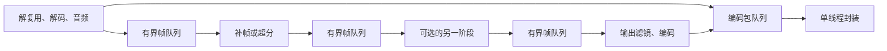

# 有界视频处理流水线与 GPU 像素路径

日期：2026-10-16，2026-10-17 更新。

## 背景与约束

RTX 5070 Ti 的 1080p、FSRCNNX M 2×、RIFE Lite 4×、NVENC 任务供料不足。原实现由一个线程依次执行解码、补帧、逐块超分、CPU 张量转换、输出滤镜、编码和封装。单纯增加异步任务不能消除像素搬运与同步点。

参考相邻 Dlss5TestDemo 的 `BoundedFramePipeline`：固定容量、显式引用所有权、失败时取消并 join。继续遵守 ADR 0006 的时钟、处理顺序、场景切换与 HDR 限制，以及 ADR 0008 的模型精度、GPU 后端和禁止隐式 CPU 回退约束。不新增 ONNX Runtime，不改变模型权重。

## 决策

每个滤镜图、编码器和推理上下文只有一个使用者。阶段之间通过 `av_frame_clone` / `av_packet_clone` 交接引用，消费完成即释放。帧队列容量 1–4，按最大图像尺寸取约 64 MiB 预算；包队列容量 64。单帧超过预算时仍允许一个引用。这不是整个进程的内存上限。

BGRA 输出采用 FFmpeg 原生帧池，只复用 `av_frame_is_writable` 为真的缓冲。每阶段保留 2–6 个槽位，目标预算 128 MiB；全部被下游引用时使用一个额外的替换缓冲。替换时直接 unref/get_buffer，避免 `make_writable` 复制即将全部覆盖的旧像素。Skia `InstallPixels` 只借用仍然存活的 AVFrame，不拥有或释放其像素。负步长和其他格式继续走 swscale。

NVIDIA TensorRT RTX 与 RAVU R2 DirectML 路径使用嵌入的无权重 ONNX GraphProto 模板。派生图保存在模型缓存中，以内容 SHA256 命名并复核缓存完整性。原始模型仍走下载器的 SHA256 校验与模型目录迁移锁。模板生成脚本只用于开发，应用运行不依赖 Python。

- 超分把 BGRA→RGB、归一化、精度转换、量化、裁边和打包放入 GPU 图，CPU 只复制输入边界和最终 BGRA 字节。目标位图借用最终 AVFrame，消除整帧结果的额外复制。
- 分块超分使用独立会话、独立输入输出张量与 RunOptions。至少八块才并行。默认根据 NVIDIA 独立显存及 CPU 核心数选择 1/2/4 会话；诊断变量 `FANCYTOOL_VIDEO_SR_WORKERS` 可覆盖为 1–8。会话在模型存储锁内预先创建，租约内不再懒加载模型文件。保留缓存总预算为十个会话槽位。RAVU R2 的 DirectML 路径默认最多两个独立上下文。
- NVIDIA SR 在 EP 支持且实测有益时，以 `HOST_ACCESSIBLE` 分配器持有固定主机输入输出，减少传输中转；RAVU R3 与 RIFE 保留普通主机缓冲，避免单项优化拖慢复用输入的组合。其他路径保留原缓冲区。不增加 CUDA 运行库。
- 相同 BGRA 输入只在已知无状态模型租约中复用上一帧超分结果。源帧和结果各保留一个引用，像素完整比较，时间戳仍逐帧更新。
- RIFE 使用前处理、**未改写的原始网络**、输出打包三个 GPU 会话，通过同一设备的 GPU 内存和 I/O Binding 衔接。FP32 中间张量不读回 CPU。保留网络会话边界，避免融合带来的字节舍入差异。CPU 输入在内容变化时重新绑定，时间参数每次重新绑定；同步和取消收尾均包含绑定操作。
- RIFE 只保留一个当前尺寸/模型的复合会话，跨任务复用；切换尺寸或模型前释放旧会话。服务租约串行，不允许复用中的可变张量被另一个任务覆盖。
- RAVU R2 保持 DirectML 后端，同样使用严格 GPU 像素图。GPU 像素适配不可用时保留原来的硬件张量路径，不放宽 CPU 回退策略。该路径复用固定形状 OrtValue；多块时用三个槽位重叠 CPU 准备、单会话推理和拼接。CPU RIFE 转换有 AVX2、SSE2、标量实现。

本机 Windows ML NVIDIA EP 的两个 CUDA Graph 会话并发 Run 会产生黑块。独立输入/会话/流和显式同步不能消除；关闭 Graph 的并发对照没有出现错误。因此并行 SR、NVIDIA SR+RIFE 组合关闭捕获，独立上下文可并发；保留捕获的路径通过全局读写锁与这些上下文隔离。并非所有 GPU 或所有版本的 TensorRT 都有此问题，不能把本机实测推广成库的通用限制。配置项见 [ORT TensorRT RTX 文档](https://onnxruntime.ai/docs/execution-providers/TensorRTRTX-ExecutionProvider.html)。

RAVU Lite R3 原图的 `Einsum(hwzk,hwk->zhw)` 在本机 EP 的 sm1200 cuDNN 编译失败。派生图以 Unsqueeze→Mul→ReduceSum→Transpose 表达相同归约，保留权重和 FP32 类型，恢复厂商 GPU 执行。归约次序的数值差异单独与 CPU 参考核对，不能宣称与原 GPU 逐字节一致。

首个 worker 失败会取消全部等待；退出前等待所有原生调用及工作线程结束，再销毁上下文、缓冲及租约。取消回调或单个 Dispose 失败不能跳过其他资源。完成通知在全部 worker 结束后发布。单独超分预览源帧；含补帧的预览最终处理帧。

## 替代方案与被撤回的实验

无界队列、同一上下文并发 Run、不等待 GPU 完成便释放张量均不采用。RIFE 全图融合和更大的模型 batch 会改变部分字节结果，未作为等价优化交付。增加到八个 SR 会话没有稳定收益；RIFE 双/四会话和限制 ORT CPU 线程数反而降速，未保留。块大小继续遵循现有用户设置，不为特定模型覆盖它。

## 后果与验证范围

增加有界在途图像和编译上下文，减少 CPU 供料、像素转换与逐帧分配造成的空闲。GPU 运算不代表整个应用不使用 CPU：解码、音频、场景判断、调度、部分色彩滤镜、字节复制和编码提交仍需要 CPU。NVENC 是独立编码引擎，不能通过单个 SM 百分比判断整个设备吞吐。

可选 `FANCYTOOL_VIDEO_PROFILE` 输出 CSV。计时为墙钟；原生 Run 包含传输、同步和锁等待。不同线程可重叠，嵌套阶段不可重复相加。设备级 GPU 遥测也不是内核占用分析。

实际吞吐、完整像素对照、全部模型组合、负向实验与复现命令见 [2026-10-17 实测报告](../video-pipeline-2026-10-17.md)。未宣称零分配、GPU 100% 或数学上不可进一步优化。其他 GPU、桌面交互和 Linux 原生设备运行仍需相应机器验证。
