**English** | [**中文**](README.md)

<div align="center">
  


  <h1>FancyTool</h1>

  <h3>妙妙工具</h3>

  <h4>
    A lightweight desktop toolkit built with Avalonia 12 + FluentAvalonia<br>
    Targeting Windows and Linux, bundling common encryption, communication, and image utilities
  </h4>

  <div>
    <a href="https://github.com/Johnwikix/LittleFancyToolAva/releases/latest"></a>
    
    
    
    
    
    
  </div>

  <div>
    <a href="https://github.com/Johnwikix/LittleFancyToolAva"></a>
    
    
    
  </div>

  <br>

</div>

<br>

## 📥 Download & Install

<div align="center">

| Microsoft Store (Recommended) |
| :---: |
| <a href="https://apps.microsoft.com/detail/9P543GHQQKVK?referrer=appbadge&mode=direct"></a><br>Get the best installation and update experience via Microsoft Store |

</div>

<br>

## 🌟 Features

### 🛰️ Communication Debug

- 🛰️ **Serial Port Debug**: send / receive over COM ports via `System.IO.Ports`
- 🌐 **TCP Server**: TCP server-side debug tool with connection management
- 📡 **UDP Communication**: UDP send / receive debug with HEX / ASCII switching

### 🔐 Encryption & Encoding

- 🔒 **Symmetric Ciphers**: DES, AES, SM4 (national cipher)
- 🔑 **Asymmetric Ciphers**: RSA, SM2 (national cipher) key pair generation and encryption
- #️⃣ **Hashing**: MD5, SHA family, SM3 (national cipher) digests
- 🅱️ **Base64 Codec**: Base64 encode / decode for text

### 🗂️ File & Image Tools

- 📁 **Folder Compare**: compare two folders and list differences by relative path, SHA-256 hash, and music title
- 🔐 **File Encryption**: batch file-level encryption / decryption with progress tracking
- 🖼️ **Image → Base64**: convert an image into a Base64 string
- 🖼️ **Image Convert**: batch image format conversion (jpg / png / bmp / webp / tiff / dds / jxl / heic / ico, powered by SkiaSharp)

### Video transcoding

The Filters tab offers RIFE AI interpolation and model-free CPU motion compensation, with 2×, 4×, or 6× the source frame rate. Playback duration and audio sync are preserved, with scene-cut protection enabled by default. RIFE 4.25 Lite (default) and 4.25 use Windows ML GPU/NPU providers with DirectML GPU fallback. Models download on demand into the shared model directory's `Interpolation` subfolder and support verification and directory migration. With interpolation enabled, GIF uses the selected multiplier too; HDR sources require an explicit Force SDR selection. The combined processing order is automatic or can be selected manually. When upscaling is disabled, output downscaling runs before interpolation to reduce processing cost. NPU compilation may take longer for large frames; GPU is recommended for speed.

The Quality tab contains AI video enhancement and HDR output controls. Choose Same as Source, Force HDR or Force SDR. Force HDR expands SDR through BT.2446 inverse tone mapping to a 1000-nit target with 10-bit PQ / BT.2020 output. Force SDR tone-maps HDR to BT.709. Same as Source retains SDR, PQ or HLG; GIF is always SDR. Incompatible eight-bit encoders or profiles report an error.

Video enhancement offers six tiers: Anime4K CNN S/M, FSRCNNX s/m and RAVU Lite r2/r3. Models are bundled for offline installation and verification in the managed model directory's `VideoSr` subfolder. Inference requires a GPU, with a validated backend selected automatically and no CPU fallback. Anime4K / FSRCNNX support optional FP16 through vendor GPU acceleration (OpenVINO on Intel); RAVU r2 uses DirectML FP32 and r3 uses vendor GPU FP32. Install GPU acceleration if compatible components are missing. Batch videos lease compiled sessions exclusively and reuse them. 2× runs once and 4× runs twice, using more time and memory. Legacy video selections migrate to Anime4K S; image enhancement retains its existing models. See [model provenance and licenses](FancyTool/Libraries/VideoSr/NOTICE.md).

Enhancement and interpolation use bounded queues so decoding, inference, encoding and muxing can process different frames concurrently. NVIDIA enhancement uses independent tile sessions, while RIFE preprocessing, inference and packing exchange GPU tensors. Pixel conversion stays on the GPU where supported; decoding, audio, scheduling and necessary byte copies still use the CPU. RAVU R2 also supports a DirectML GPU pixel graph; other unsupported paths retain their hardware tensor implementation. Cancellation or failure joins in-flight work before native resources are released. See the [pipeline design](FancyTool/docs/adr/0010-bounded-video-processing-pipeline.md) and [RTX 5070 Ti measurements](FancyTool/docs/video-pipeline-2026-10-17.md).

The existing enhancement models process SDR images. HDR inputs are tone-mapped before enhancement and converted back according to the output selection. Inverse tone mapping can expand highlights but cannot guarantee recovery of detail already lost in SDR. See the [design record](FancyTool/docs/adr/0005-model-storage-and-hdr-output.md) for algorithms and model storage behavior.

### Lyrics and subtitles

Open **Audio/Video → Lyrics & subtitles** for recursive folder scanning, drag and drop, batch processing, pause, cancellation, retries and queue recovery. Recognition uses Qwen3-ASR 1.7B; word timing uses Qwen3-ForcedAligner 0.6B. Both reuse ONNX Runtime and bundled FFmpeg without Python. Chinese, English, Japanese, Korean, French, Spanish, Russian, German and Portuguese have recognition and word alignment; Italian and Cantonese also have alignment. Other recognition languages retain chunk timing.

INT4 with Windows DirectML GPU acceleration is the default for both recognition and alignment. All profiles enable “Prefer GPU acceleration” by default. GPU loading or inference errors automatically retry the affected step on CPU; results show the actual backend, a fallback notice and the underlying diagnostic reason. Disable this option to force CPU. DirectML may only partially offload INT4 decoder MatMulNBits nodes; choose High Precision/FP32 for full decoder GPU execution. Non-Windows systems use CPU. Auto language first uses script hints from audio tags and the filename; without a script hint, one Qwen3-ASR session scores Chinese, English, Japanese, Korean, French, Spanish, Russian, German and Portuguese over at most two 8-second windows at the beginning and end of the track. The resource-saving profile uses fewer threads and shorter chunks; the high-precision profile uses FP32 weights. Default downloads total about 5 GB; FP32 adds about 10 GB and needs more memory. If a GPU or driver produces incorrect recognition, disable GPU and retry.

Exports include LRC, ELRC, KRC, QRC, YRC, SRT, VTT, ASS, TXT and JSON, plus an editable `.fancylyrics.json` project. Every generated format is readable UTF-8 text: KRC keeps word timing tags without the vendor compression/encryption wrapper, and QRC uses compatible plaintext XML. Valid embedded synchronized lyrics and matching sidecars can be reused; untimed tags fall back to recognition. Leaving the output directory empty writes lyric/subtitle sidecars next to each source audio. Results support text editing, realignment and a global time offset. Singing, accompaniment and overlapping vocals can affect timing; zero-duration words are flagged for review.

Settings → Model Management chooses the storage root for image/video upscaling and default lyrics models, with open-folder and restore-default actions. Changes apply after restart; existing models can be copied manually to the new folder. Default lyrics models use its `Qwen3Lyrics` subfolder; explicit overrides in lyrics advanced settings remain available. Models use pinned revisions and SHA-256 checks, then run offline. New extraction results receive a numeric suffix when an output already exists. Queue recovery restarts interrupted files and preserves completed projects. The copied Lyricify helper retains its System.Text.Json source-generation changes; licensing is recorded in `FancyTool/External/NOTICE-Lyrics.txt`. The application's existing FFmpeg dynamic bindings continue to require managed publishing rather than NativeAOT.

`FancyTool/_tools/LyricsSmokeTest` contains format and inference checks. `FANCYTOOL_DATA_DIRECTORY`, `FANCYTOOL_LYRICS_MODELS` and `FANCYTOOL_LYRICS_DATA` allow isolated application data, model caches and queues. QA artifacts remain under the ignored `.qa/lyrics` folder. Network lyric sources are test-only comparison oracles and never replace Qwen3-ASR output; run `network .qa/lyrics/network D:\music\MP3\song.mp3` to compare Lyricify Helper's Netease and QQ Music results.

## 📊 Feature Matrix

| Category | Tool | Description | Algorithm / Implementation | Main Dependency |
| :--- | :--- | :--- | :--- | :--- |
| Comms | Serial Port Debug | COM port send/receive | `System.IO.Ports` | System.IO.Ports |
| Comms | TCP Server | TCP server debug | `TcpListener` / `Socket` | .NET BCL |
| Comms | UDP Communication | UDP send/receive | `UdpClient` | .NET BCL |
| Symmetric | DES | DES cipher | DES | BouncyCastle.Cryptography |
| Symmetric | AES | AES cipher | AES | BouncyCastle.Cryptography |
| Symmetric | SM4 | SM4 national cipher | SM4 | BouncyCastle.Cryptography |
| Asymmetric | RSA | RSA cipher | RSA | BouncyCastle.Cryptography |
| Asymmetric | SM2 | SM2 national cipher | SM2 | BouncyCastle.Cryptography |
| Hash | MD5 | MD5 digest | MD5 | BouncyCastle.Cryptography |
| Hash | SHA | SHA-1/256/384/512 | SHA family | BouncyCastle.Cryptography |
| Hash | SM3 | SM3 national digest | SM3 | BouncyCastle.Cryptography |
| Encoding | Base64 | Text encode/decode | Base64 | .NET BCL |
| File | Folder Compare | Diff two directories | SHA-256 hash / music title | .NET BCL / ATL |
| File | File Encryption | Batch file encrypt / decrypt | AES / SM4 (extensible) | BouncyCastle.Cryptography |
| Image | Image → Base64 | Image → Base64 | Stream encoding | .NET BCL |
| Image | Image Convert | Batch image format conversion (jpg / png / bmp / webp / tiff / dds / jxl / heic / ico) | SKBitmap decode + multi-format encode + multi-size ICO packing | SkiaSharp |

## 🖼️ Screenshots

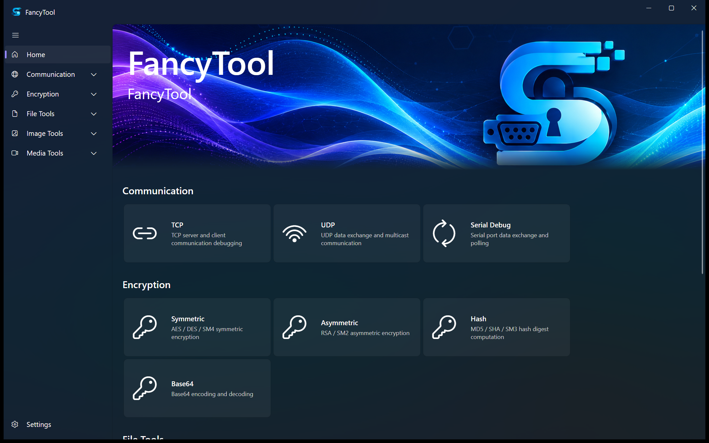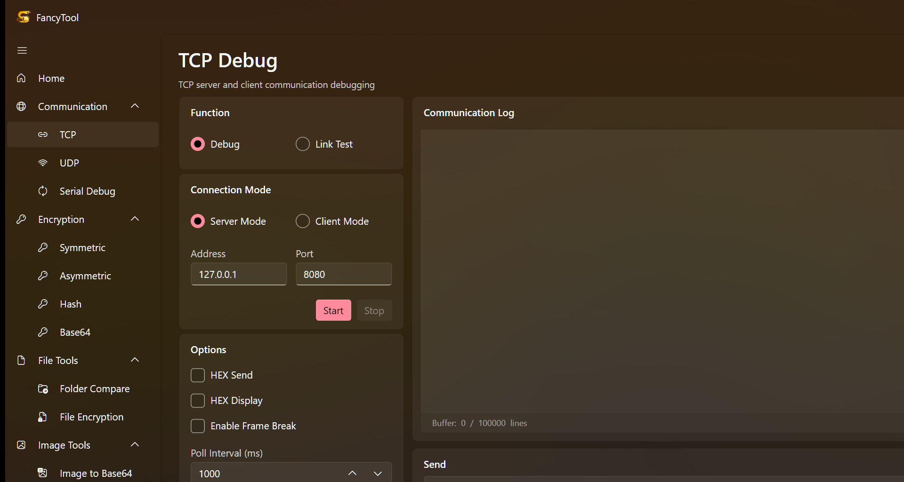
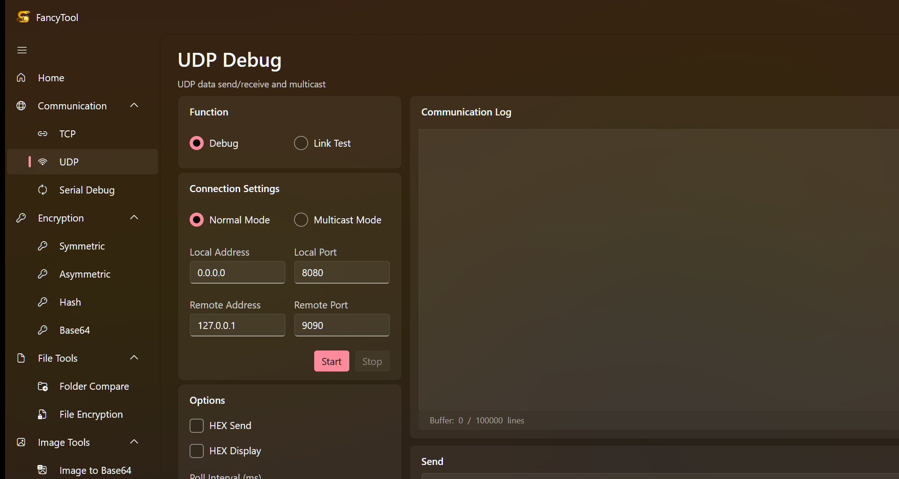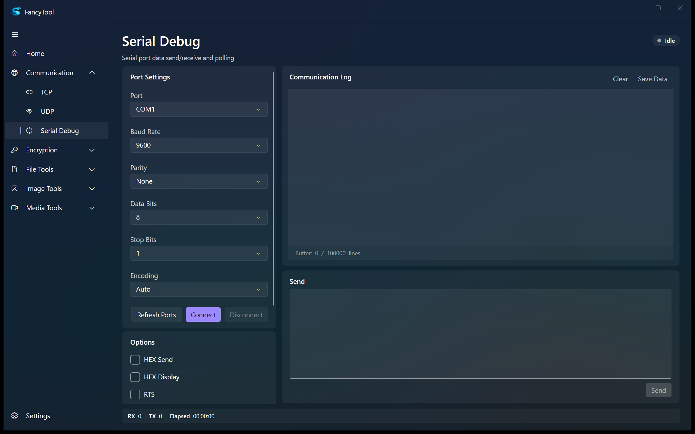
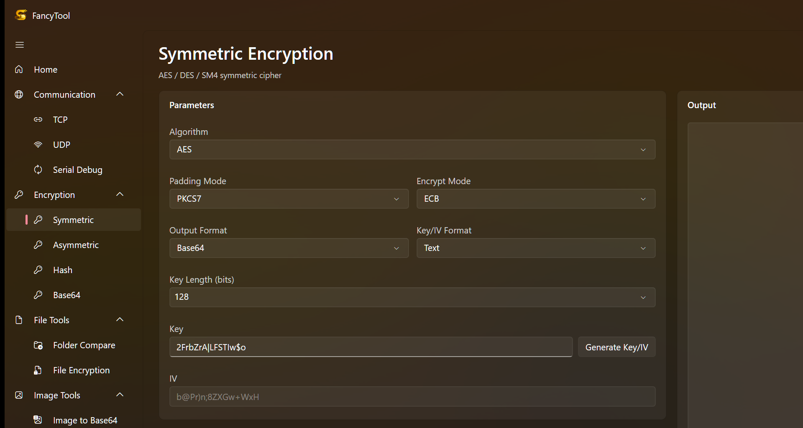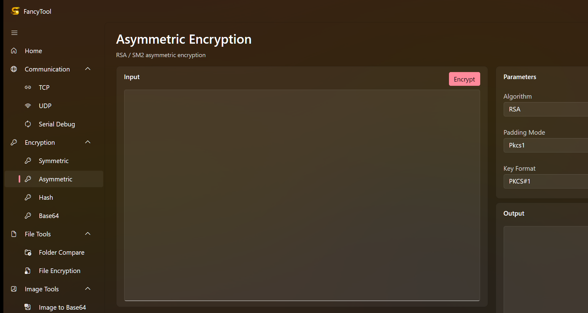
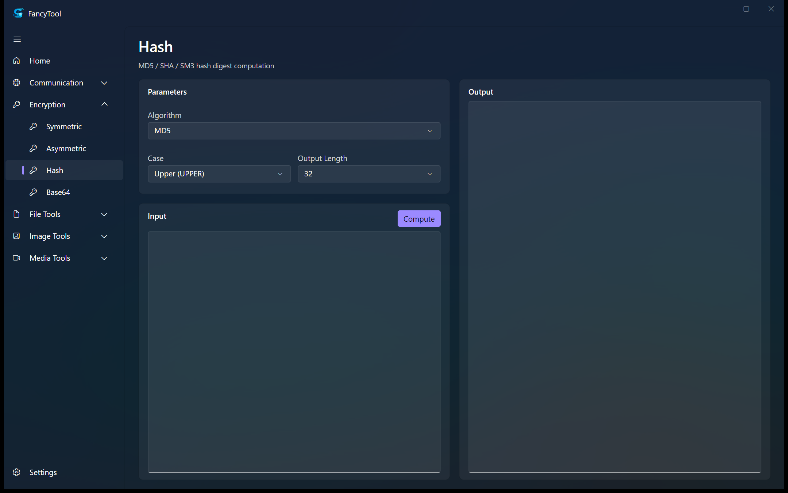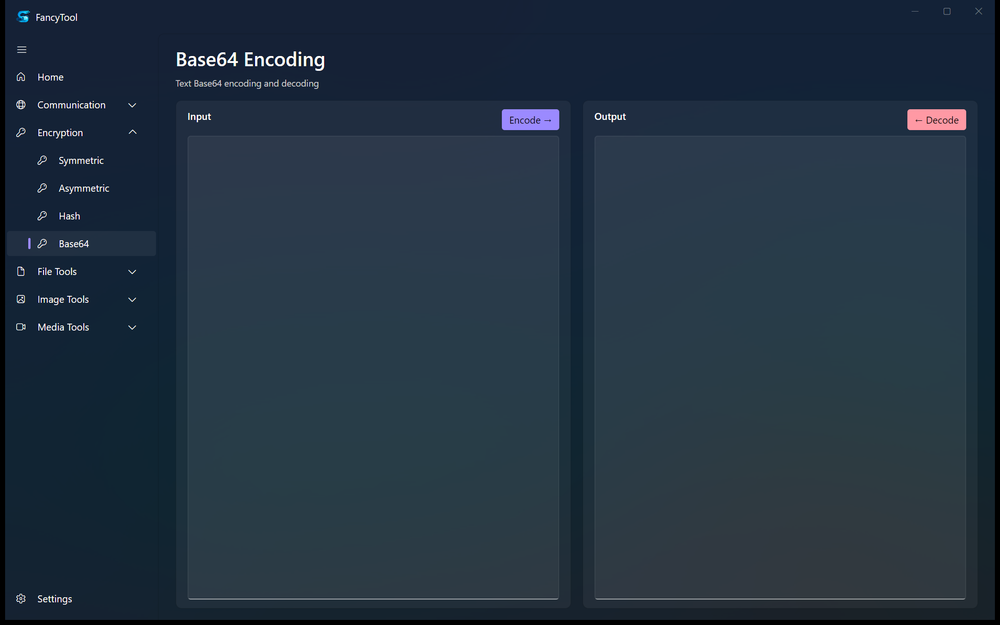
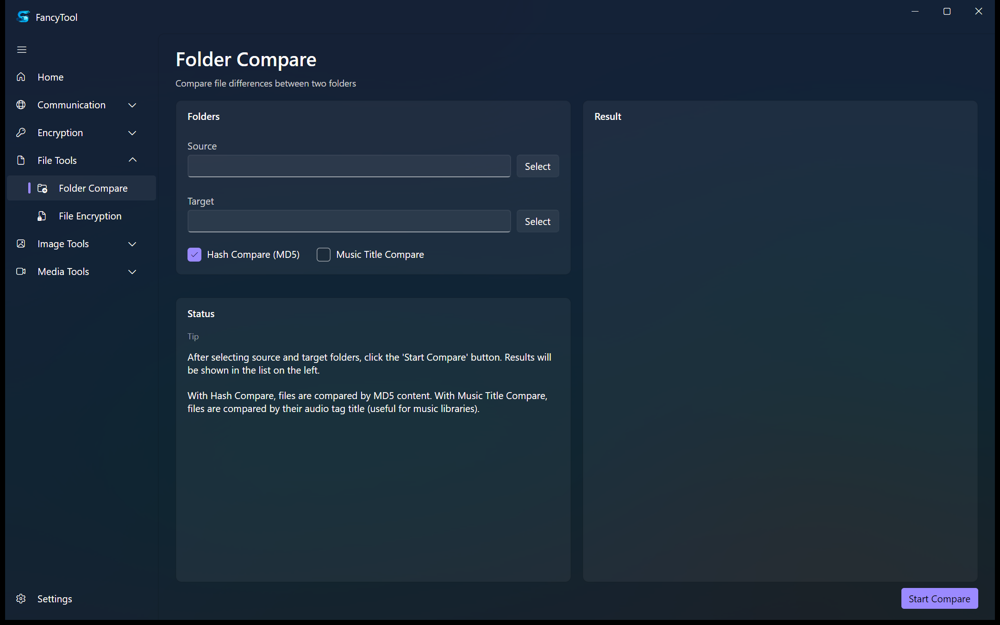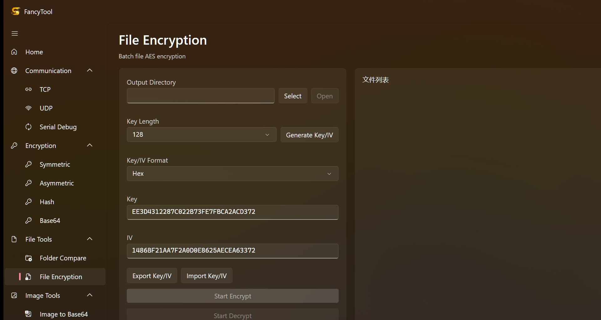
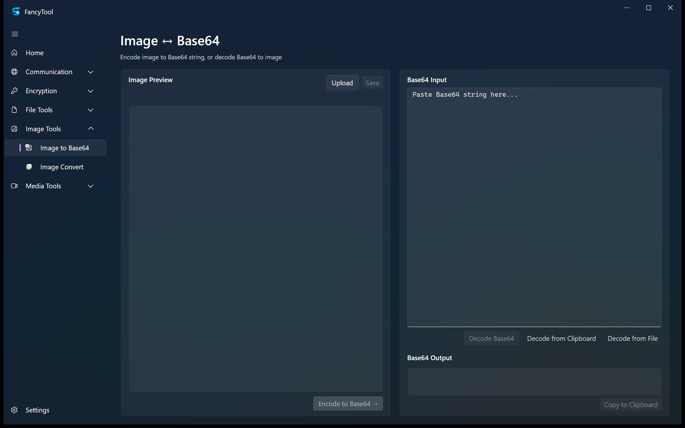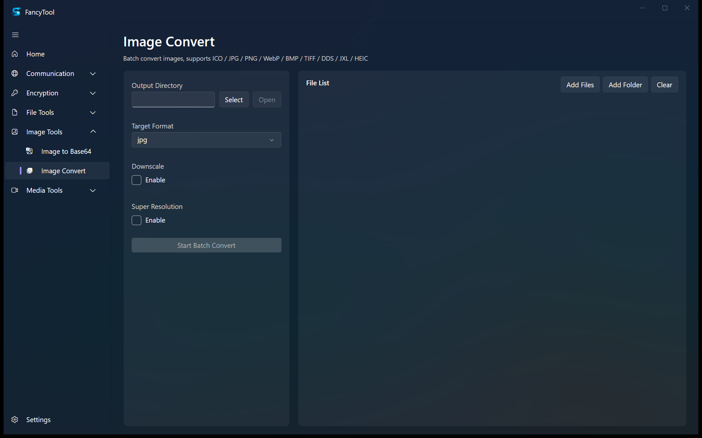


## 🧱 Architecture

- **UI**: Avalonia 12 desktop + FluentAvalonia 3.0 (FANavigationView / Frame / ContentDialog family); supports System / Light / Dark themes
- **MVVM**: `CommunityToolkit.Mvvm` with `[ObservableProperty]` / `[RelayCommand]` source generation
- **Dependency Injection**: `Microsoft.Extensions.DependencyInjection` container wires up services, ViewModels and algorithms (`AddSingleton` / `AddTransient` / `AddKeyedSingleton`) in `App.axaml.cs`
- **Navigation**: `NavigationFactory` implements `IFANavigationPageFactory`; `FAFrame.NavigateFromObject` jumps between pages; `IViewLifecycle` hooks fire on entry / exit
- **State Persistence**: `IViewStateService` serializes per-tool page state; `AppPreferences` persists theme, animations, shadows, notification placement, etc.; `ApplicationHostService` calls `LoadState` / `LoadViewStates` on launch and `SaveState` on exit
- **Logging**: `Serilog` 4 + `Serilog.Extensions.Logging` bridging `Microsoft.Extensions.Logging`; daily-rolling output to `{AppBaseDirectory}\logs\tool-.log`, capped at 50 MB per file, 30 days retained
- **Stability**: `Program.cs` registers `AppDomain.UnhandledException` and `TaskScheduler.UnobservedTaskException`; startup failures surface through `MessageBoxW`
- **Publishing**: Self-contained managed publishing for FFmpeg dynamic bindings (`PublishAot=false`); `FolderProfile.pubxml` provides `SelfContained` + `PublishSingleFile` folder publishing; two PowerShell scripts at the repo root act as entry points — `publish-win.ps1` (Windows x64 self-contained publish) and `publish-linux-deb.ps1` (`.deb` packaging backed by the `Packaging.Targets` `CreateDeb` MSBuild target); both wrap `dotnet` subprocess calls

## 🛠️ Build

### Prerequisites

- [.NET 10 SDK](https://dotnet.microsoft.com/) (SDK version and `rollForward` policy are pinned in `global.json`)
- Windows 10 19041 or later
- Linux x64 (e.g. Ubuntu 22.04+; `.deb` runtime dependencies required)
- Visual Studio 2026 recommended

### Build from Source

A PowerShell build script ships at the repo root. It defaults to `Release` / `win-x64` and enables NativeAOT:

```powershell
# Windows PowerShell 5.1+ or PowerShell 7+
pwsh -File .\publish-win.ps1
```

Optional parameters:

```powershell
# Custom configuration and output directory
pwsh -File .\publish-win.ps1 -Configuration Debug -Output .\out\debug
```

Output is placed at `bin\Release\net10.0-windows10.0.19041.0\win-x64\publish\win-x64\`. Launch `FancyToolAva.exe` to start the app.

### Debug Run

For quick iteration outside the script, use the dotnet CLI directly:

```bash
dotnet run -c Debug
```

### Cross-Platform Distribution

- Linux x64 `.deb` package: run `pwsh -File .\publish-linux-deb.ps1` at the repo root; output lands in `dist\`
- Any-RID self-contained publish: `dotnet publish -c Release -r <RID> -p:PublishSelfContained=true` (or via `Properties\PublishProfiles\FolderProfile.pubxml`: `dotnet publish -c Release -p:PublishProfile=FolderProfile`)

> ⚠️ **Note**: The Linux version has not been fully verified and may have compatibility issues.

## 💖 Dependencies & Credits

### Third-Party Libraries

| Library | Purpose | License |
| :--- | :--- | :--- |
| [Avalonia](https://avaloniaui.net/) | Cross-platform UI framework | MIT |
| [Avalonia.Desktop](https://avaloniaui.net/) | Desktop runtime | MIT |
| [Avalonia.Fonts.Inter](https://avaloniaui.net/) | Inter font | MIT |
| [FluentAvaloniaUI](https://github.com/amwx/FluentAvalonia) | Fluent Design control library | MIT |
| [CommunityToolkit.Mvvm](https://github.com/CommunityToolkit/dotnet) | MVVM source generator | MIT |
| [Microsoft.Extensions.DependencyInjection](https://learn.microsoft.com/dotnet/core/extensions/dependency-injection) | DI container | MIT |
| [Microsoft.Extensions.Logging](https://learn.microsoft.com/dotnet/core/extensions/logging) | Logging abstractions | MIT |
| [Serilog](https://serilog.net/) | Structured logging | Apache-2.0 |
| [Serilog.Extensions.Logging](https://github.com/serilog/serilog-extensions-logging) | Serilog ↔ MEL bridge | Apache-2.0 |
| [Serilog.Sinks.File](https://github.com/serilog/serilog-sinks-file) | File log sink | Apache-2.0 |
| [BouncyCastle.Cryptography](https://www.bouncycastle.org/csharp/) | Ciphers (AES / DES / RSA / SM2 / SM3 / SM4 / SHA / MD5) | MIT |
| [z440.atl.core](https://github.com/Zeugma440/atldotnet) | Audio metadata (music title extraction) | MIT |
| [System.IO.Ports](https://learn.microsoft.com/dotnet/api/system.io.ports) | Serial port communication | MIT |
| [Lang.Avalonia](https://github.com/avaloniaui/avalonia) | i18n runtime (`I18nManager` / `lan:I18n`) | MIT |
| [Lang.Avalonia.Json](https://github.com/avaloniaui/avalonia) | JSON i18n plugin (`i18n\*.json`) | MIT |
| [Avalonia.Skia](https://github.com/AvaloniaUI/Avalonia) | Skia renderer (transitive via Avalonia Desktop) | MIT |
| [SkiaSharp](https://github.com/mono/SkiaSharp) | Image processing & format conversion (directly drives ICO / PNG / JPEG / WebP / HEIF / GIF / BMP encoding) | MIT |
| [HarfBuzzSharp](https://github.com/harfbuzz/harfbuzz-sharp) | Text shaping (transitive via Avalonia Desktop) | MIT |
| [FFmpeg](https://ffmpeg.org/) | Video/audio transcoding (FFmpeg 9.0.1 GPL shared libs bundled with the app, called in-process via FFmpeg.AutoGen; see `FancyTool/Libraries/FFmpeg/BUILD_INFO.md`) | GPL-3.0 |
| [FFmpeg.AutoGen](https://github.com/Ruslan-B/FFmpeg.AutoGen) | .NET bindings for the FFmpeg C API | MIT |
| [Packaging.Targets](https://github.com/qmfrederik/dotnet-packaging) | Linux `.deb` packaging (`CreateDeb` MSBuild target) | MIT |

## 📄 License

This project is licensed under the [GPL-3.0 License](LICENSE).

The video transcode feature bundles FFmpeg 9.0.1 GPL shared libraries (which include GPL components such as
libx264/libx265; placed next to the app executable, license text shipped as `Licenses/FFmpeg.txt`). Because of
this bundling, the repository license changed from MIT to GPL-3.0.

## 🗂️ Data Storage

Application data is stored at:

- **Preferences & logs**: `%LocalAppData%\FancyTool\` (under MSIX the system transparently redirects this to the package's LocalCache; on Linux the equivalent is `~/.local/share/fancy-tool/`)
- **Log subdirectory**: `logs\`, daily rolling, ≤ 50 MB per file, 30 days retained
- **Per-tool page state**: serialized by `IViewStateService` on exit and restored on launch
- **App preferences** : managed by `AppPreferences`
- **Super-resolution models**: stored under `Models\` and **downloaded automatically from HuggingFace on first launch** (via `hf-mirror.com` first, falling back to the official source). Once downloaded, they remain on disk for offline use. Models are no longer shipped inside the installer.
  - Power users can override the mirror by setting the `HF_ENDPOINT` environment variable.
  - If you used an older build that stored `preferences.json` next to the executable, it is migrated to `%LocalAppData%\FancyTool\` on first launch.

---
