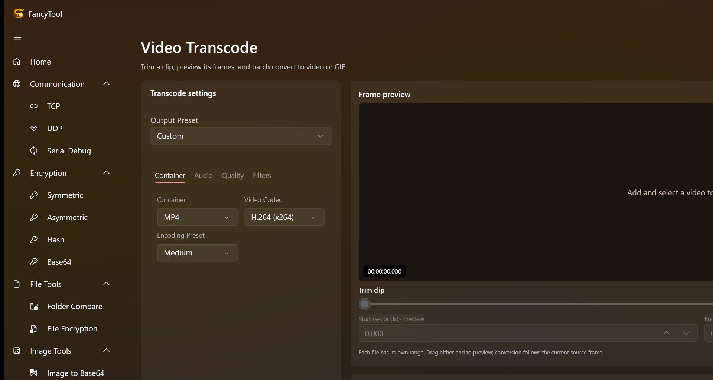
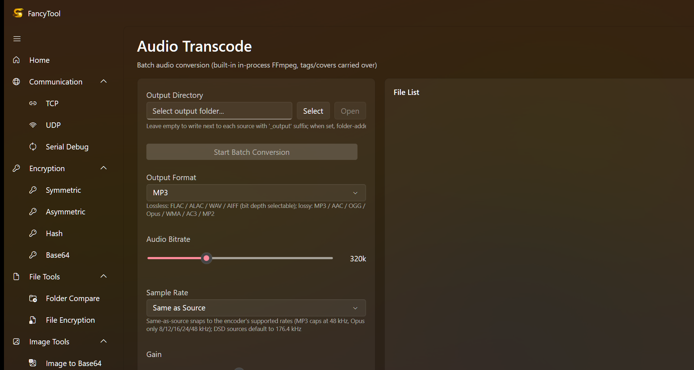
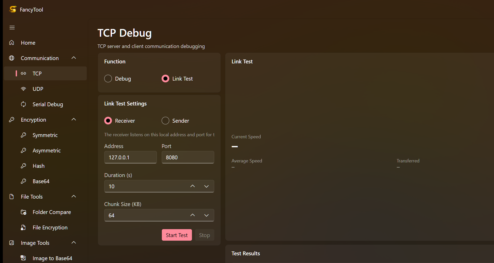
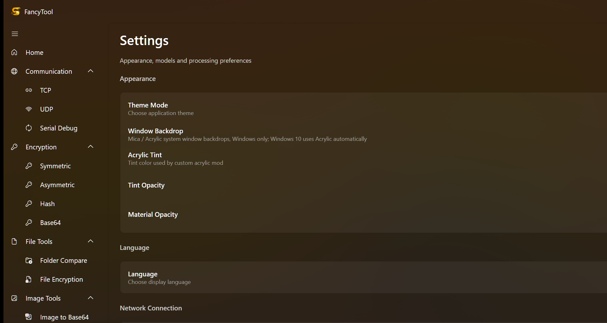

**English** | [**中文**](README.md)

<div align="center">
  


  <h1>FancyTool</h1>

  <h3>妙妙工具</h3>

  <h4>
    A lightweight desktop toolkit built with Avalonia 12 + FluentAvalonia<br>
    Targeting Windows and Linux, bundling communication debugging, encryption, file, image and media tools
  </h4>

  <div>
    <a href="https://github.com/Johnwikix/LittleFancyToolAva/releases/latest"></a>
    
    
    
    
    
    
  </div>

  <div>
    <a href="https://github.com/Johnwikix/LittleFancyToolAva"></a>
    
    
    
  </div>

  <br>

</div>

<br>

## 📥 Download & Install

<div align="center">

| Microsoft Store (Recommended) |
| :---: |
| <a href="https://apps.microsoft.com/detail/9P543GHQQKVK?referrer=appbadge&mode=direct"></a><br>Get the best installation and update experience via Microsoft Store |

</div>

The MSIX edition requires a valid full license or an unexpired Store trial. All tools are locked when the trial expires, the license is inactive, or verification fails. Expired trials offer a purchase option; verification errors explain the problem. Settings shows the current license status and trial expiration. Losing authorization during use ends the tool session and reopens the license screen; unfinished output files may be incomplete. Non-MSIX Windows and Linux releases remain fully unlocked. See the [license policy](FancyTool/docs/adr/0016-msix-application-license.md).

<br>

## 🌟 Features

### 🛰️ Communication Debug

- 🛰️ **Serial Port Debug**: send / receive over COM ports via `System.IO.Ports`
- 🌐 **TCP Server**: TCP server-side debug tool with connection management, plus an independent link-test mode for TCP bandwidth
- 📡 **UDP Communication**: UDP send / receive debug with HEX / ASCII switching, plus an independent link-test mode for UDP bandwidth and packet loss

### 🔐 Encryption & Encoding

- 🔒 **Symmetric Ciphers**: DES, AES, SM4 (national cipher)
- 🔑 **Asymmetric Ciphers**: RSA, SM2 (national cipher) key pair generation and encryption
- #️⃣ **Hashing**: MD5, SHA family, SM3 (national cipher) digests
- 🅱️ **Base64 Codec**: Base64 encode / decode for text

### 🗂️ File & Image Tools

- 📁 **Folder Compare**: compare two folders and list differences by relative path, SHA-256 hash, and music title
- 🔐 **File Encryption**: batch file-level encryption / decryption with progress tracking
- 🖼️ **Image → Base64**: convert an image into a Base64 string
- 🖼️ **Image Convert**: batch image format conversion (jpg / png / bmp / webp / tiff / dds / jxl / heic / ico, powered by SkiaSharp)

Image enhancement offers four models: RealESRGAN x4plus, x4plus anime, general x4v3 and ClearReality V1, with 2× / 4× output and ClearReality selected by default. Models with noncommercial licenses have been removed. Legacy selections of removed models fall back to ClearReality; other model selections and valid scales are preserved. See the [model removal decision](FancyTool/docs/adr/0015-remove-noncommercial-image-models.md).

Transparent image conversion and alpha compositing use SIMD acceleration. See the [image / video GPU validation report](FancyTool/docs/gpu-inference-validation-2026-10-23.md) for hardware tests, output comparisons, and performance limits.

### 🎬 Video Transcoding

Video transcoding runs FFmpeg in-process (GPL shared libraries bundled with the app) and batch-converts common container × video/audio codec combinations, with GIF export. The Filters and Quality tabs add the following enhancements:

The Filters tab offers RIFE AI interpolation and model-free CPU motion compensation, with 2×, 4×, or 6× the source frame rate. Playback duration and audio sync are preserved, with scene-cut protection enabled by default. RIFE 4.25 Lite (default) and 4.25 use Windows ML GPU/NPU providers with DirectML GPU fallback. Models download on demand into the shared model directory's `Interpolation` subfolder and support verification and directory migration. With interpolation enabled, GIF uses the selected multiplier too; RIFE can tone-map HDR input and produce 10-bit HDR output; other interpolation modes require Force SDR. The combined processing order is automatic or can be selected manually. When upscaling is disabled, output downscaling runs before interpolation to reduce processing cost. NPU compilation may take longer for large frames; GPU is recommended for speed.

NVIDIA optical flow uses `fruc_vulkan`, requires the necessary driver capabilities including `VK_NV_optical_flow`, and is exposed only after real 2×/4×/6× frame generation probes pass. RTX 5070 Ti has been verified. This path uploads and downloads frames; it is not the CUDA GPU-resident path. CPU motion compensation uses `minterpolate`, whose core does not support slice threading, so low overall CPU utilization can still mean a saturated single core.

The Quality tab contains AI video enhancement and HDR output controls. Choose Same as Source, Force HDR or Force SDR. Force HDR expands SDR through BT.2446 inverse tone mapping to a 1000-nit target with 10-bit PQ / BT.2020 output. Force SDR tone-maps HDR to BT.709. Same as Source retains SDR, PQ or HLG; GIF is always SDR. Incompatible eight-bit encoders or profiles report an error.

Video enhancement offers six tiers: Anime4K CNN S/M, FSRCNNX s/m and RAVU Lite r2/r3. Models are bundled for offline installation and verification in the managed model directory's `VideoSr` subfolder. Inference requires a GPU, with a validated backend selected automatically and no CPU fallback. Anime4K / FSRCNNX support optional FP16 through vendor GPU acceleration (OpenVINO on Intel); RAVU r2 uses DirectML FP32 and r3 uses vendor GPU FP32. Install GPU acceleration if compatible components are missing. Batch videos lease compiled sessions exclusively and reuse them. 2× runs once and 4× runs twice, using more time and memory. Legacy video selections migrate to Anime4K S. See [model provenance and licenses](FancyTool/Libraries/VideoSr/NOTICE.md).

Enhancement and interpolation use bounded queues so decoding, inference, encoding and muxing can process different frames concurrently. On Windows, NVIDIA encoding tasks prefer NVDEC. Common 8-bit SDR and 10-bit 4:2:0 PQ/HLG input can stay in GPU memory through CUDA color conversion, tone mapping, enhancement, RIFE and NVENC, using P010 hardware frames for HDR. Scene detection reads back flags, and previews are resized on the GPU before download. Audio, scheduling and muxing still use the CPU. Special filters, color formats and DirectML retain hybrid processing; failed hardware format negotiation restarts software decoding. GPU color conversion has rounding and sampling differences from zscale, so outputs are not pixel-identical. See the [GPU frame design](FancyTool/docs/adr/0011-gpu-resident-video-frames.md) and [RTX 5070 Ti measurements](FancyTool/docs/video-cuda-pipeline-2026-10-17.md).

The existing enhancement and RIFE models process SDR images. HDR inputs are tone-mapped before inference and expanded to a 1000-nit HDR target when requested. Inverse tone mapping can expand highlights but cannot guarantee recovery of detail already lost in SDR. See the [design record](FancyTool/docs/adr/0005-model-storage-and-hdr-output.md) for algorithms and model storage behavior, and the [HDR GPU design](FancyTool/docs/adr/0012-hdr-cuda-video-pipeline.md) and [HDR measurements](FancyTool/docs/video-hdr-cuda-2026-10-17.md) for GPU behavior and limits.

### 🎵 Audio Transcoding

Audio transcoding also runs FFmpeg in-process with batch conversion, writing tags and cover art through: lossless output covers FLAC / ALAC / WAV / AIFF (optional bit depth, Auto infers 16/24/32-bit or float from the source), lossy output covers MP3 / AAC / OGG / Opus / WMA / AC3 / MP2. Sample rate can follow the source and is aligned to each encoder's supported table (MP3 caps at 48 kHz, Opus only 8/12/16/24/48 kHz, DSD sources default to 176.4 kHz). A built-in DSP upsampler restores high frequencies and raises the sample rate of 44.1/48 kHz mono/stereo PCM input; the multiplier sets the target rate, up to 192 kHz, available for lossless output only.

## 📊 Feature Matrix

| Category | Tool | Description | Algorithm / Implementation | Main Dependency |
| :--- | :--- | :--- | :--- | :--- |
| Comms | Serial Port Debug | COM port send/receive | `System.IO.Ports` | System.IO.Ports |
| Comms | TCP Server | TCP server debug + link test (TCP bandwidth) | `TcpListener` / `Socket` | .NET BCL |
| Comms | UDP Communication | UDP send/receive + link test (bandwidth & packet loss) | `UdpClient` | .NET BCL |
| Symmetric | DES | DES cipher | DES | BouncyCastle.Cryptography |
| Symmetric | AES | AES cipher | AES | BouncyCastle.Cryptography |
| Symmetric | SM4 | SM4 national cipher | SM4 | BouncyCastle.Cryptography |
| Asymmetric | RSA | RSA cipher | RSA | BouncyCastle.Cryptography |
| Asymmetric | SM2 | SM2 national cipher | SM2 | BouncyCastle.Cryptography |
| Hash | MD5 | MD5 digest | MD5 | BouncyCastle.Cryptography |
| Hash | SHA | SHA-1/256/384/512 | SHA family | BouncyCastle.Cryptography |
| Hash | SM3 | SM3 national digest | SM3 | BouncyCastle.Cryptography |
| Encoding | Base64 | Text encode/decode | Base64 | .NET BCL |
| File | Folder Compare | Diff two directories | SHA-256 hash / music title | .NET BCL / ATL |
| File | File Encryption | Batch file encrypt / decrypt | AES / SM4 (extensible) | BouncyCastle.Cryptography |
| Image | Image → Base64 | Image → Base64 | Stream encoding | .NET BCL |
| Image | Image Convert | Batch image format conversion (jpg / png / bmp / webp / tiff / dds / jxl / heic / ico) | SKBitmap decode + multi-format encode + multi-size ICO packing | SkiaSharp |
| Image | Image Super-Resolution | AI image upscaling (2× / 4×, GPU accelerated) | RealESRGAN / ClearReality and more (ONNX inference) | ONNX Runtime / Windows ML |
| Media | Video Transcode | Batch video transcoding & GIF export with HDR output, AI super-resolution and frame interpolation | FFmpeg filter graph + GPU-resident pipeline (NVDEC/NVENC) + SR/interpolation models | FFmpeg.AutoGen / ONNX Runtime |
| Media | Audio Transcode | Batch audio conversion with DSP upsampling (up to 192 kHz) | FFmpeg encoding + managed DSP upsampler | FFmpeg.AutoGen |

## 🖼️ Screenshots






## 🧱 Architecture

- **UI**: Avalonia 12 desktop + FluentAvalonia 3.0 (FANavigationView / Frame / ContentDialog family); supports System / Light / Dark themes
- **MVVM**: `CommunityToolkit.Mvvm` with `[ObservableProperty]` / `[RelayCommand]` source generation
- **Dependency Injection**: `Microsoft.Extensions.DependencyInjection` container wires up services, ViewModels and algorithms (`AddSingleton` / `AddTransient` / `AddKeyedSingleton`) in `App.axaml.cs`
- **Navigation**: `NavigationFactory` implements `IFANavigationPageFactory`; `FAFrame.NavigateFromObject` jumps between pages; `IViewLifecycle` hooks fire on entry / exit
- **State Persistence**: `IViewStateService` serializes per-tool page state; `AppPreferences` persists theme, animations, shadows, notification placement, etc.; `ApplicationHostService` calls `LoadState` / `LoadViewStates` on launch and `SaveState` on exit
- **Logging**: `Serilog` 4 + `Serilog.Extensions.Logging` bridging `Microsoft.Extensions.Logging`; daily-rolling output to `{AppBaseDirectory}\logs\tool-.log`, capped at 50 MB per file, 30 days retained
- **Stability**: `Program.cs` registers `AppDomain.UnhandledException` and `TaskScheduler.UnobservedTaskException`; startup failures surface through `MessageBoxW`
- **Publishing**: Self-contained NativeAOT publishing (`csproj` defaults `PublishAot=true`; the bundled FFmpeg shared libraries bind through static P/Invoke and are AOT-compatible); the MSIX packaging path uses managed publishing (`FancyToolMsixBuild=true` forces `PublishAot=false` because the entry project needs a regular apphost); `FolderProfile.pubxml` provides `SelfContained` + `PublishSingleFile` folder publishing; two PowerShell scripts in the `FancyTool` folder act as entry points — `publish-win.ps1` (Windows x64 self-contained NativeAOT publish) and `publish-linux-deb.ps1` (`.deb` packaging backed by the `Packaging.Targets` `CreateDeb` MSBuild target); both wrap `dotnet` subprocess calls

## 🛠️ Build

### Prerequisites

- [.NET 10 SDK](https://dotnet.microsoft.com/) (SDK version and `rollForward` policy are pinned in `global.json`)
- Windows 10 19041 or later
- Linux x64 (e.g. Ubuntu 22.04+; `.deb` runtime dependencies required)
- Visual Studio 2026 recommended

### Build from Source

A PowerShell build script ships in the `FancyTool` folder. It defaults to `Release` / `win-x64`, with NativeAOT enabled by the `csproj` default:

```powershell
# Windows PowerShell 5.1+ or PowerShell 7+
pwsh -File .\FancyTool\publish-win.ps1
```

Optional parameters:

```powershell
# Custom configuration and output directory
pwsh -File .\FancyTool\publish-win.ps1 -Configuration Debug -Output .\out\debug
```

Output is placed at `bin\Release\net10.0-windows10.0.19041.0\win-x64\publish\win-x64\`. Launch `FancyToolAva.exe` to start the app.

### Debug Run

For quick iteration outside the script, use the dotnet CLI directly:

```bash
dotnet run -c Debug
```

### Cross-Platform Distribution

- Linux x64 `.deb` package: run `pwsh -File .\publish-linux-deb.ps1` from the `FancyTool` folder; output lands in `FancyTool\dist\`. The script does not override `PublishAot`, so cross-OS AOT requires the target toolchain — pass `-p:PublishAot=false` for a managed self-contained build
- Windows MSIX package: packaged through the `FancyToolAva.Msix` project (`FancyToolMsixBuild=true` uses the dedicated `bin/msix` / `obj/msix` output); the icon resampling script lives at `FancyToolAva.Msix/generate-msix-icons.ps1`. See [ADR 0009](FancyTool/docs/adr/0009-msix-entry-point-output-metadata.md) for generation and verification
- Any-RID self-contained publish: `dotnet publish -c Release -r <RID> -p:PublishSelfContained=true` (or via `Properties\PublishProfiles\FolderProfile.pubxml`: `dotnet publish -c Release -p:PublishProfile=FolderProfile`)

> ⚠️ **Note**: The Linux version has not been fully verified and may have compatibility issues.

## 💖 Dependencies & Credits

### Third-Party Libraries

| Library | Purpose | License |
| :--- | :--- | :--- |
| [Avalonia](https://avaloniaui.net/) | Cross-platform UI framework | MIT |
| [Avalonia.Desktop](https://avaloniaui.net/) | Desktop runtime | MIT |
| [Avalonia.Fonts.Inter](https://avaloniaui.net/) | Inter font | MIT |
| [FluentAvaloniaUI](https://github.com/amwx/FluentAvalonia) | Fluent Design control library | MIT |
| [CommunityToolkit.Mvvm](https://github.com/CommunityToolkit/dotnet) | MVVM source generator | MIT |
| [Microsoft.Extensions.DependencyInjection](https://learn.microsoft.com/dotnet/core/extensions/dependency-injection) | DI container | MIT |
| [Microsoft.Extensions.Logging](https://learn.microsoft.com/dotnet/core/extensions/logging) | Logging abstractions | MIT |
| [Serilog](https://serilog.net/) | Structured logging | Apache-2.0 |
| [Serilog.Extensions.Logging](https://github.com/serilog/serilog-extensions-logging) | Serilog ↔ MEL bridge | Apache-2.0 |
| [Serilog.Sinks.File](https://github.com/serilog/serilog-sinks-file) | File log sink | Apache-2.0 |
| [BouncyCastle.Cryptography](https://www.bouncycastle.org/csharp/) | Ciphers (AES / DES / RSA / SM2 / SM3 / SM4 / SHA / MD5) | MIT |
| [z440.atl.core](https://github.com/Zeugma440/atldotnet) | Audio metadata (music title extraction) | MIT |
| [System.IO.Ports](https://learn.microsoft.com/dotnet/api/system.io.ports) | Serial port communication | MIT |
| [Lang.Avalonia](https://github.com/avaloniaui/avalonia) | i18n runtime (`I18nManager` / `lan:I18n`) | MIT |
| [Lang.Avalonia.Json](https://github.com/avaloniaui/avalonia) | JSON i18n plugin (`i18n\*.json`) | MIT |
| [Avalonia.Skia](https://github.com/AvaloniaUI/Avalonia) | Skia renderer (transitive via Avalonia Desktop) | MIT |
| [SkiaSharp](https://github.com/mono/SkiaSharp) | Image processing & format conversion (directly drives ICO / PNG / JPEG / WebP / HEIF / GIF / BMP encoding) | MIT |
| [HarfBuzzSharp](https://github.com/harfbuzz/harfbuzz-sharp) | Text shaping (transitive via Avalonia Desktop) | MIT |
| [FFmpeg](https://ffmpeg.org/) | Video/audio transcoding (FFmpeg GPL shared libraries (pinned N-127579, compatible with the 9.0 binding ABI) bundled with the app, called in-process via FFmpeg.AutoGen; the binaries are not tracked — run `FancyTool/Libraries/FFmpeg/fetch-ffmpeg.ps1` before the first build, see `FancyTool/Libraries/FFmpeg/BUILD_INFO.md`) | GPL-3.0 |
| [FFmpeg.AutoGen](https://github.com/Ruslan-B/FFmpeg.AutoGen) | .NET bindings for the FFmpeg C API | MIT |
| [Packaging.Targets](https://github.com/qmfrederik/dotnet-packaging) | Linux `.deb` packaging (`CreateDeb` MSBuild target) | MIT |

## 📄 License

This project is licensed under the [GPL-3.0 License](LICENSE).

The video transcode feature bundles FFmpeg GPL shared libraries (pinned N-127579, compatible with the 9.0 binding ABI; these include GPL components such as
libx264/libx265; placed next to the app executable, license text shipped as `Licenses/FFmpeg.txt`). Because of
this bundling, the repository license changed from MIT to GPL-3.0.
The six library binaries are not tracked (each exceeds GitHub's 100 MB limit); run
`pwsh -File FancyTool/Libraries/FFmpeg/fetch-ffmpeg.ps1` before the first build to fetch and verify them.

## 🗂️ Data Storage

Application data is stored at:

- **Preferences & logs**: `%LocalAppData%\FancyTool\` (under MSIX the system transparently redirects this to the package's LocalCache; on Linux the equivalent is `~/.local/share/fancy-tool/`)
- **Log subdirectory**: `logs\`, daily rolling, ≤ 50 MB per file, 30 days retained
- **Per-tool page state**: serialized by `IViewStateService` on exit and restored on launch
- **App preferences** : managed by `AppPreferences`
- **Model directory**: Settings → Model Management chooses the shared model root (applies after restart, with open-folder and restore-default actions). Image super-resolution models **download automatically from HuggingFace in the background on first launch** (via `hf-mirror.com` first, falling back to the official source) and remain for offline use. RIFE interpolation models (`Interpolation` subfolder) download on demand with pinned revisions and SHA-256 verification. Video super-resolution models (`VideoSr` subfolder) ship with the app and can be verified offline.
  - Power users can override the mirror by setting the `HF_ENDPOINT` environment variable.
  - If you used an older build that stored `preferences.json` next to the executable, it is migrated to `%LocalAppData%\FancyTool\` on first launch.

---
