[**English**](README.en.md) | **中文**

<div align="center">
  


  <h1>妙妙工具</h1>

  <h3>FancyTool</h3>

  <h4>
    基于 Avalonia 12 + FluentAvalonia 构建的轻量级桌面工具集<br>
    面向 Windows 与 Linux 平台，集成通信调试、加密、文件、图片与音视频处理工具
  </h4>
  <div>
    <a href="https://github.com/Johnwikix/LittleFancyToolAva/releases/latest"></a>
    
    
    
    
    
    
  </div>

  <div>
    <a href="https://github.com/Johnwikix/LittleFancyToolAva"></a>
    
    
    
  </div>


  <br>

</div>

<br>

## 📥 下载与安装

<div align="center">

| Microsoft Store（推荐） |
| :---: |
| <a href="https://apps.microsoft.com/detail/9P543GHQQKVK?referrer=appbadge&mode=direct"></a><br>通过 Microsoft Store 获取最佳安装与更新体验 |

</div>

MSIX 版需要有效正式许可或尚未到期的 Store 试用许可；试用到期、许可无效或验证失败时，全部工具锁定。试用到期提供购买入口，验证异常显示具体原因；设置页可查看授权状态及试用到期时间。运行中授权失效会结束工具会话并重新进入授权页，未完成的输出可能不完整。非 MSIX 的 Windows 与 Linux 发布完全解锁。详见 [授权策略](FancyTool/docs/adr/0016-msix-application-license.md)。

<br>

## 🌟 核心功能

### 🛰️ 通信调试

- 🛰️ **串口调试**：基于 `System.IO.Ports` 的串口收发与调试
- 🌐 **TCP 服务器**：TCP 服务端调试工具，支持连接管理；附加链路测试（独立模式）测环回/局域网 TCP 带宽
- 📡 **UDP 通信**：UDP 收发调试，支持十六进制 / ASCII 切换；附加链路测试（独立模式）测 UDP 带宽与丢包率

### 🔐 加解密与编码

- 🔒 **对称加密**：DES、AES、SM4（国密）字符串加解密
- 🔑 **非对称加密**：RSA、SM2（国密）密钥对生成与加解密
- #️⃣ **哈希计算**：MD5、SHA 系列、SM3（国密）摘要
- 🅱️ **Base64 编解码**：文本 Base64 编码 / 解码

### 🗂️ 文件与图片工具

- 📁 **文件夹比较**：对比两个目录的内容与文件差异（按相对路径、SHA-256 哈希、音乐标题匹配）
- 🔐 **文件加解密**：批量的文件级加密 / 解密操作，支持进度跟踪
- 🖼️ **图片转 Base64**：将图片转换为 Base64 编码字符串
- 🖼️ **图片转换**：图片格式批量转换（jpg / png / bmp / webp / tiff / dds / jxl / heic / ico，基于 SkiaSharp）

图片超分提供 RealESRGAN x4plus、x4plus anime、general x4v3 和 ClearReality V1 四款模型，支持 2× / 4×，默认使用 ClearReality。已移除采用非商业许可的模型；旧版本中选择这些模型的设置会回退到 ClearReality，其他模型选择和有效倍率保持不变。详见[模型移除决策](FancyTool/docs/adr/0015-remove-noncommercial-image-models.md)。

透明图片的像素转换与透明度合成支持 SIMD 加速。保留模型的真实 GPU 复测、输出一致性和性能边界见[图片 / 视频验证报告](FancyTool/docs/gpu-inference-validation-2026-10-23.md)。

### 🎬 视频转码

视频转码基于进程内 FFmpeg（随应用分发的 GPL shared 库），批量转换常见容器 × 视频/音频编码组合，支持 GIF 导出；“滤镜”与“画质”页提供以下增强能力：

“滤镜”页支持 RIFE AI 插帧和无需模型的 CPU 运动补偿插帧，可选择 2×、4× 或 6× 源帧率，保持原时长和音画同步，并默认启用场景切换保护。AI 插帧提供 RIFE 4.25 Lite（默认）与 4.25，沿用 Windows ML 的 GPU/NPU 加速和 DirectML GPU 回退；模型按需下载至统一模型目录的 `Interpolation` 子目录，支持校验和目录迁移。开启插帧后，GIF 同样使用所选倍率；RIFE 可对 HDR 输入映射后补帧并输出 10 位 HDR；其他插帧方式仍需选择“强制 SDR”。与超分同时启用时自动选择处理顺序，也可手动选择先插帧或先超分；未开启超分的降分辨率输出会先缩小画面，以降低插帧计算量。NPU 首次编译大画面可能较慢，速度优先推荐 GPU。

NVIDIA 光流使用 `fruc_vulkan`，要求驱动暴露 `VK_NV_optical_flow` 等所需能力，并通过应用的 2×/4×/6× 实际生成帧校验；RTX 5070 Ti 已验证。该路径通过上传/回读接入现有处理链，尚非 CUDA 全显存路径。CPU 运动补偿的 `minterpolate` 核心不支持切片多线程，总 CPU 占用低不代表单核没有饱和。

“画质”页集中显示 AI 视频超分和 HDR 输出选项。HDR 输出可选“与源一致”“强制 HDR”“强制 SDR”：强制 HDR 将 SDR 经 BT.2446 逆映射转换为 1000 尼特目标的 10 位 PQ / BT.2020；强制 SDR 对 HDR 做亮度映射并输出 BT.709。与源一致保留 SDR、PQ 或 HLG 类型，GIF 始终输出 SDR。不支持 10 位 HDR 的编码器或档次会提示调整设置。

视频超分提供 Anime4K CNN S/M、FSRCNNX s/m 和 RAVU Lite r2/r3 六档，模型随应用分发，可离线安装与校验，存放在模型管理目录的 `VideoSr` 子目录。仅使用 GPU，按模型自动选择已验证的后端，没有 CPU 回退。Anime4K / FSRCNNX 可选 FP16，使用厂商 GPU 加速（Intel 为 OpenVINO）；RAVU r2 使用 DirectML FP32，r3 使用厂商 GPU FP32。缺少兼容组件时可点击安装 GPU 加速。批量视频独占租用并复用已编译会话。2×运行一次，4×运行两次，耗时和内存更高。旧视频模型选择会迁移到 Anime4K S。模型来源及许可见 [模型说明](FancyTool/Libraries/VideoSr/NOTICE.md)。

超分和插帧使用有界流水线，让解码、推理、编码与封装处理不同的帧。Windows 的 NVIDIA 编码任务优先使用 NVDEC；常见 8 位 SDR 和 10 位 4:2:0 PQ/HLG 输入可经 CUDA 像素转换、色调映射、超分、RIFE 直接交给 NVENC，HDR 使用 P010 硬件帧，整帧保留在显存。场景检测仅回读标志，预览先在 GPU 缩小；CPU 负责音频、调度和封装。特殊滤镜、色彩格式及 DirectML 等路径保留混合处理，硬件解码协商失败会完整重试软件解码。GPU 色彩转换与原 zscale 路径存在舍入和采样差异，不能宣称逐像素相同。设计及验证见 [显存管线设计](FancyTool/docs/adr/0011-gpu-resident-video-frames.md) 和 [RTX 5070 Ti 实测](FancyTool/docs/video-cuda-pipeline-2026-10-17.md)。

现有超分与 RIFE 模型处理 SDR 图像；HDR 素材会先映射为 SDR，再按输出选择生成 1000 尼特目标的 HDR。逆映射可扩展高光，但不能保证恢复 SDR 中已经丢失的细节。算法与模型目录说明见 [设计记录](FancyTool/docs/adr/0005-model-storage-and-hdr-output.md)，GPU 实现与边界见 [HDR 管线设计](FancyTool/docs/adr/0012-hdr-cuda-video-pipeline.md) 和 [HDR 实测](FancyTool/docs/video-hdr-cuda-2026-10-17.md)。

### 🎵 音频转码

音频转码同样基于进程内 FFmpeg，支持批量转换，标签与封面跟随写入：无损输出支持 FLAC / ALAC / WAV / AIFF（可选位深，Auto 按源推断 16/24/32bit 或 float），有损输出支持 MP3 / AAC / OGG / Opus / WMA / AC3 / MP2；采样率可跟随源并按编码器支持表自动对齐（如 MP3 上限 48 kHz、Opus 仅 8/12/16/24/48 kHz，DSD 源默认 176.4 kHz）。内置 DSP 升频：对 44.1/48 kHz 单/双声道 PCM 输入补全高频并提升采样率，倍率决定目标采样率，最高 192 kHz，仅无损输出可用。

## 📊 功能矩阵

| 类别 | 工具 | 说明 | 算法 / 实现 | 主要依赖 |
| :--- | :--- | :--- | :--- | :--- |
| 通信 | 串口调试 | 串口收发与调试 | `System.IO.Ports` | System.IO.Ports |
| 通信 | TCP 服务器 | TCP 服务端调试 + 链路测试（TCP 带宽） | `TcpListener` / `Socket` | .NET BCL |
| 通信 | UDP 通信 | UDP 收发调试 + 链路测试（带宽与丢包率） | `UdpClient` | .NET BCL |
| 对称加密 | DES | DES 加解密 | DES | BouncyCastle.Cryptography |
| 对称加密 | AES | AES 加解密 | AES | BouncyCastle.Cryptography |
| 对称加密 | SM4 | SM4 国密加解密 | SM4 | BouncyCastle.Cryptography |
| 非对称加密 | RSA | RSA 加解密 | RSA | BouncyCastle.Cryptography |
| 非对称加密 | SM2 | SM2 国密加解密 | SM2 | BouncyCastle.Cryptography |
| 哈希 | MD5 | MD5 摘要 | MD5 | BouncyCastle.Cryptography |
| 哈希 | SHA | SHA-1/256/384/512 | SHA 系列 | BouncyCastle.Cryptography |
| 哈希 | SM3 | SM3 国密摘要 | SM3 | BouncyCastle.Cryptography |
| 编码 | Base64 | 文本编解码 | Base64 | .NET BCL |
| 文件 | 文件夹比较 | 两个目录差异对比 | SHA-256 哈希 / 音乐标题 | .NET BCL / ATL |
| 文件 | 文件加解密 | 文件级加密 / 解密 | AES / SM4 等（可扩展） | BouncyCastle.Cryptography |
| 图片 | 图片转 Base64 | 图片 → Base64 | 字节流编码 | .NET BCL |
| 图片 | 图片转换 | 图片格式批量转换（jpg / png / bmp / webp / tiff / dds / jxl / heic / ico） | SKBitmap 解码 + 多格式编码 + ICO 多尺寸封装 | SkiaSharp |
| 图片 | 图片超分 | AI 图片超分辨率（2× / 4×，GPU 加速） | RealESRGAN / ClearReality 等（ONNX 推理） | ONNX Runtime / Windows ML |
| 音视频 | 视频转码 | 批量视频转码与 GIF 导出，支持 HDR 输出、AI 超分与插帧 | FFmpeg 滤镜图 + 显存管线（NVDEC/NVENC）+ 超分/插帧模型 | FFmpeg.AutoGen / ONNX Runtime |
| 音视频 | 音频转码 | 批量音频转换与 DSP 升频（最高 192 kHz） | FFmpeg 编码 + 托管 DSP 升采样 | FFmpeg.AutoGen |

## 🖼️ 软件截图

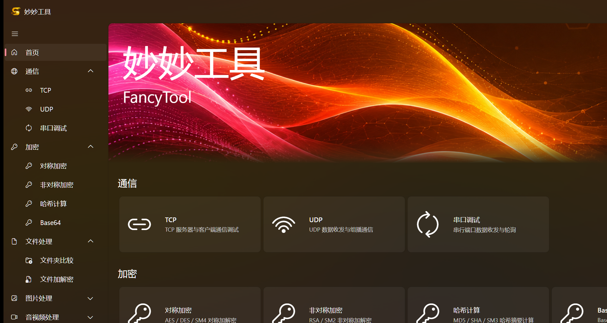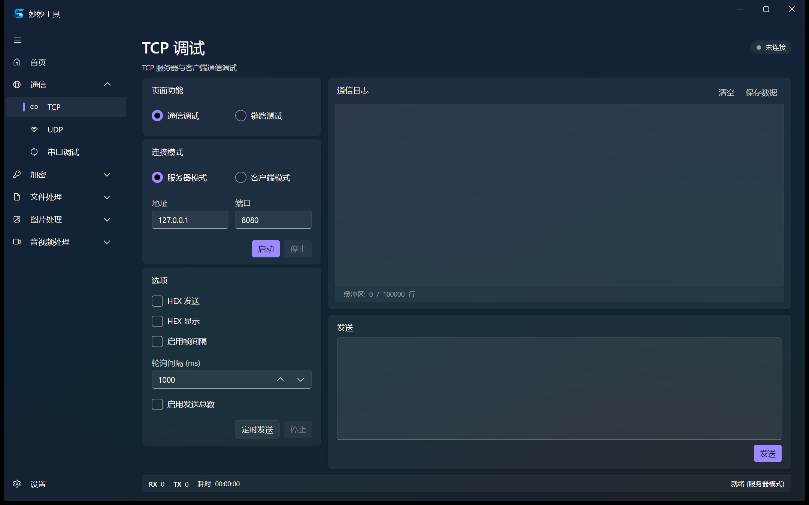
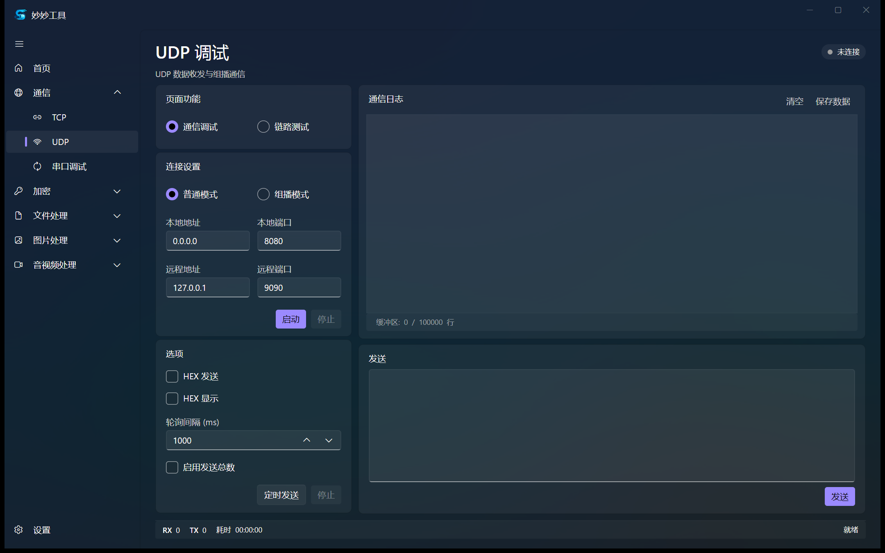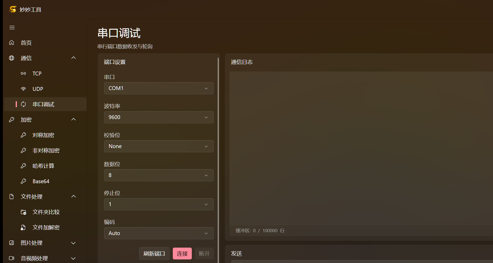
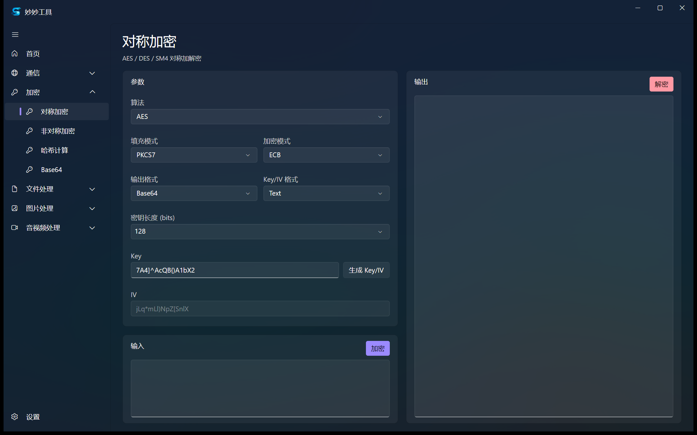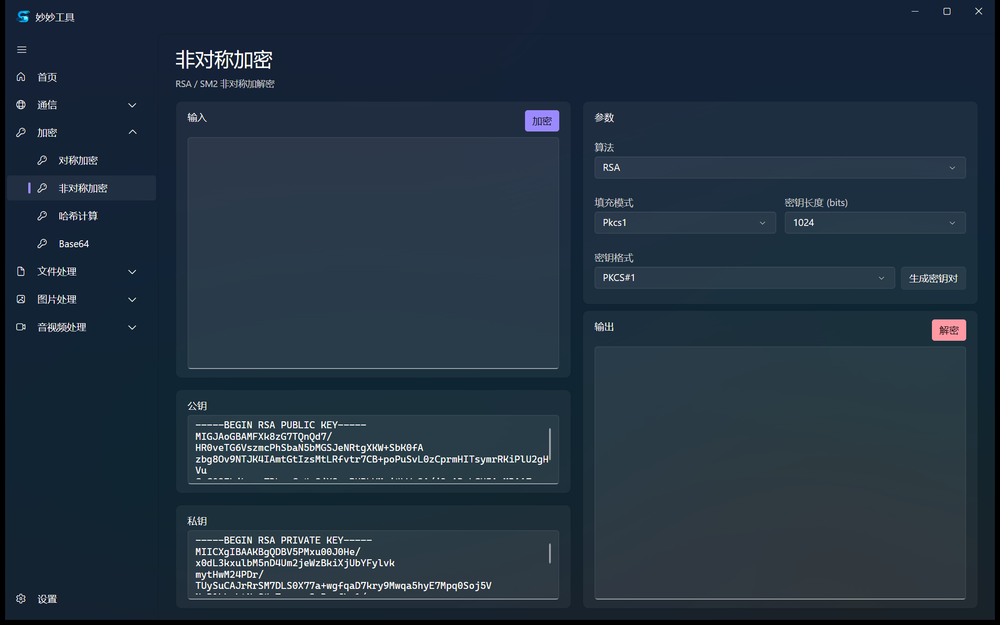
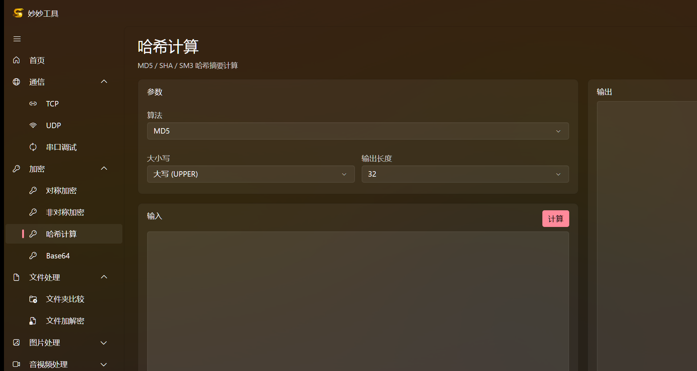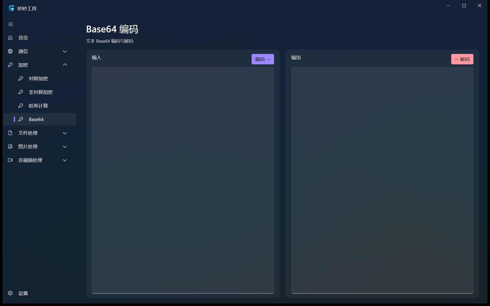
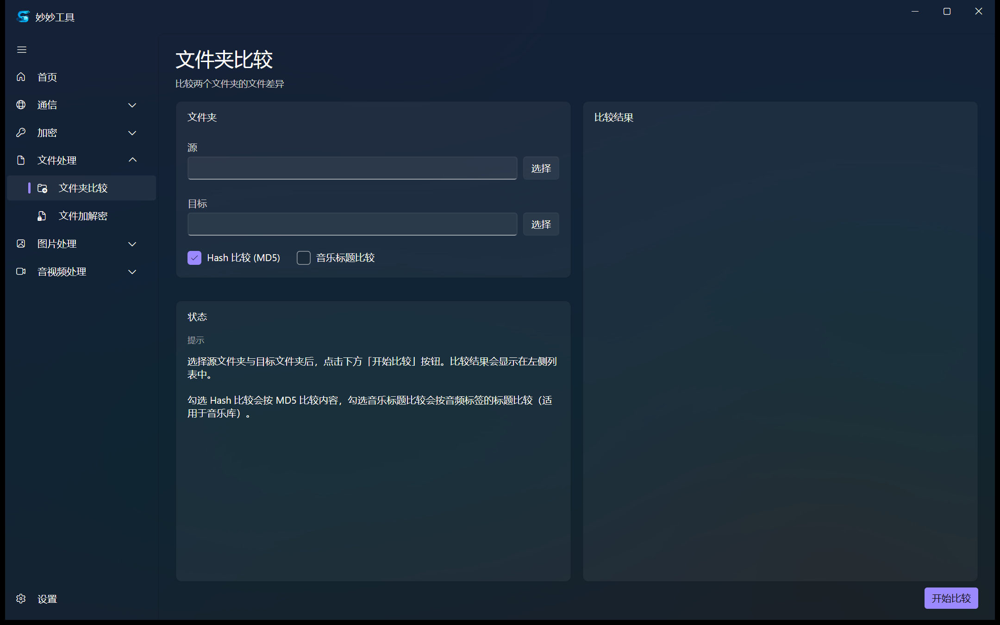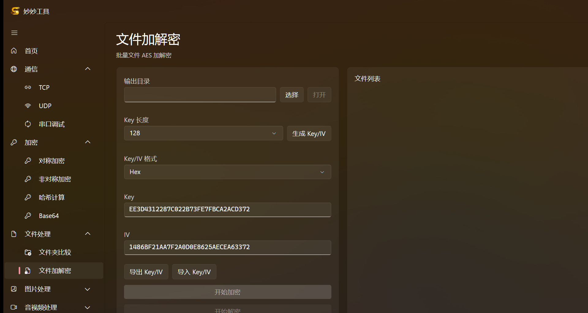
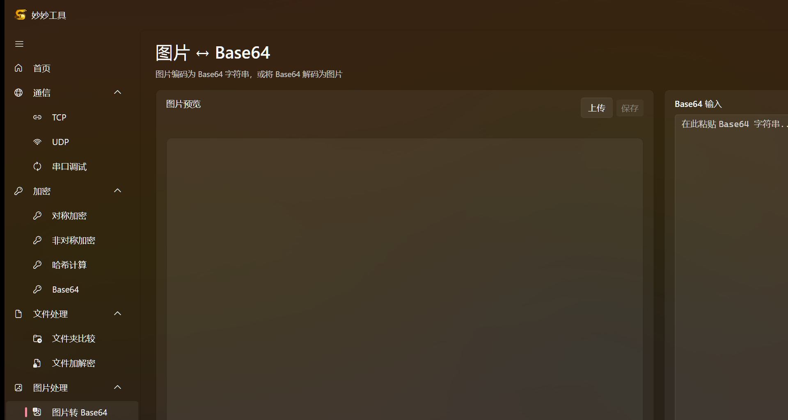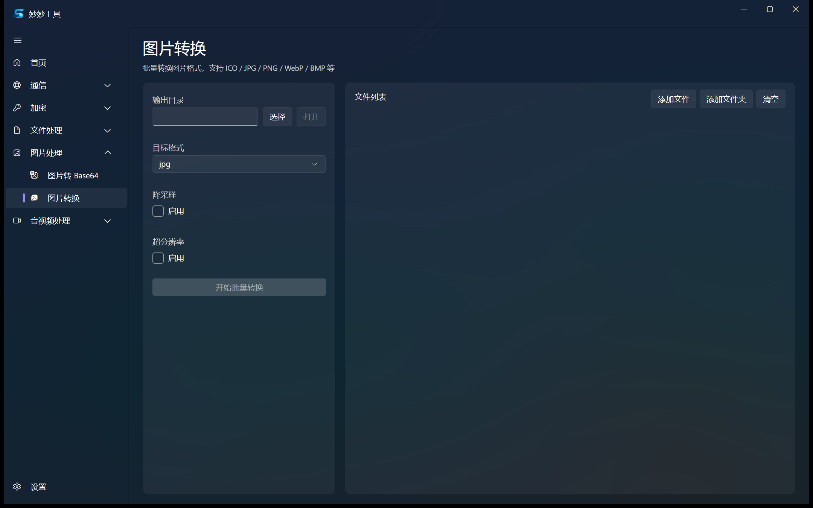
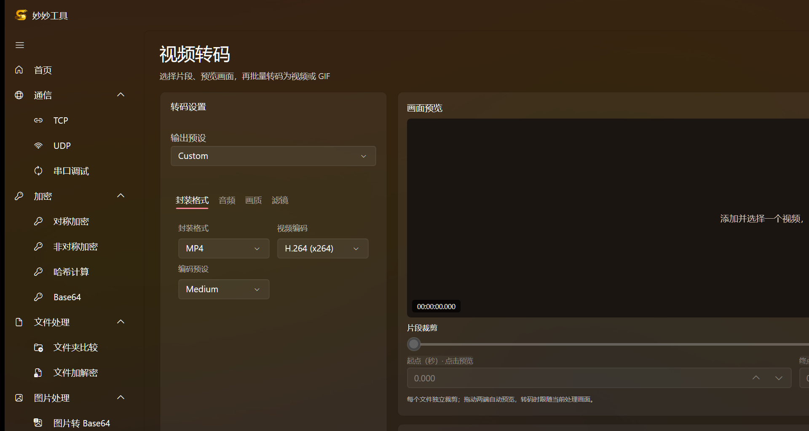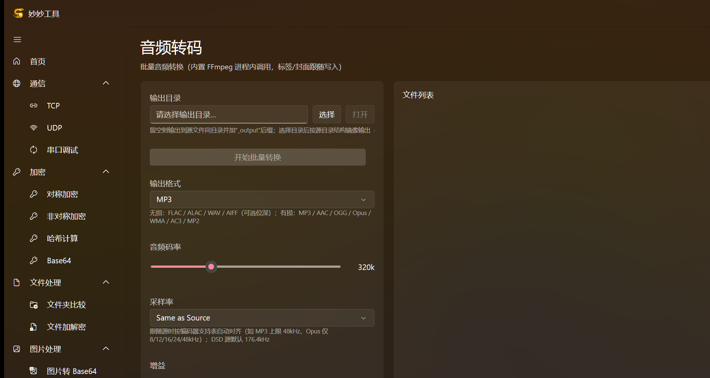
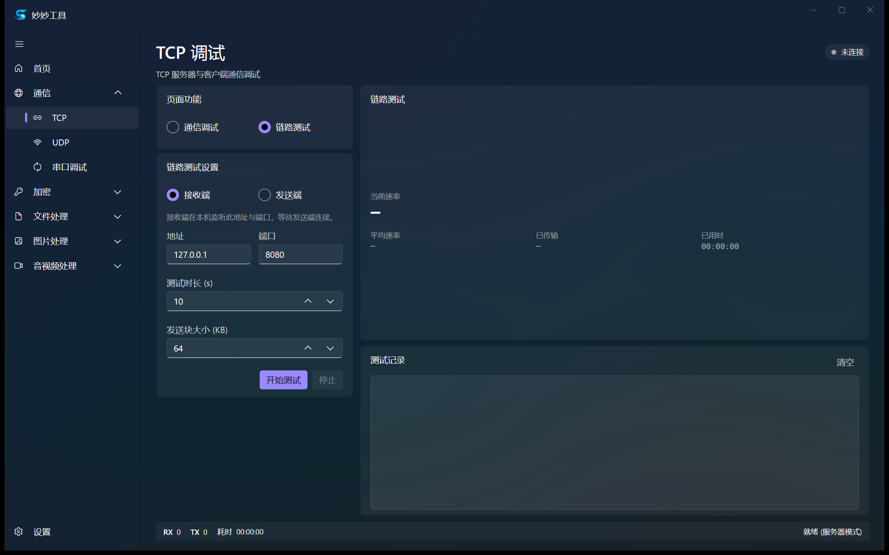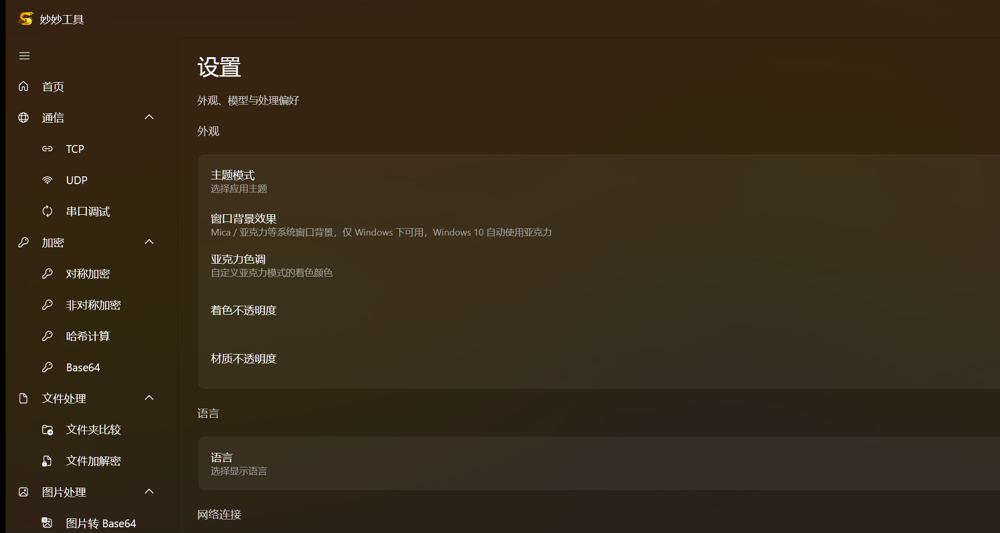

## 🧱 技术架构

- **UI**：Avalonia 12 桌面端 + FluentAvalonia 3.0（FANavigationView / Frame / ContentDialog 体系），跟随系统 / 浅色 / 深色三套主题
- **MVVM**：`CommunityToolkit.Mvvm`（`[ObservableProperty]` / `[RelayCommand]` 源生成）
- **依赖注入**：`Microsoft.Extensions.DependencyInjection` 容器统一管理 Services、ViewModels、Algorithms（`AddSingleton` / `AddTransient` / `AddKeyedSingleton`），在 `App.axaml.cs` 中配置
- **导航**：`NavigationFactory` 实现 `IFANavigationPageFactory`，通过 `FAFrame.NavigateFromObject` 跳转；`IViewLifecycle` 钩子在进入 / 离开页面时调度 ViewModel 生命周期
- **状态持久化**：`IViewStateService` 序列化各工具页面状态；`AppPreferences` 持久化主题、动画、阴影、通知位置等设置；`ApplicationHostService` 在启动时 `LoadState` / `LoadViewStates`，退出时 `SaveState`
- **日志**：`Serilog` 4 + `Serilog.Extensions.Logging` 桥接 `Microsoft.Extensions.Logging`；按天滚动写入 `{AppBaseDirectory}\logs\tool-.log`，单文件上限 50 MB，保留 30 天
- **稳定性**：`Program.cs` 注册 `AppDomain.UnhandledException` 与 `TaskScheduler.UnobservedTaskException`；启动失败时通过 `MessageBoxW` 兜底提示
- **发布**：自包含 NativeAOT 发布（`csproj` 默认 `PublishAot=true`；FFmpeg shared 库以静态 P/Invoke 绑定随应用分发，兼容 AOT）；MSIX 打包路径使用托管发布（`FancyToolMsixBuild=true` 时 `PublishAot=false`，入口工程需要普通 apphost）；`FolderProfile.pubxml` 提供 `SelfContained` + `PublishSingleFile` 文件夹发布；`FancyTool` 目录提供两个 PowerShell 脚本作为入口——`publish-win.ps1`（Windows x64 自包含 NativeAOT 发布）与 `publish-linux-deb.ps1`（基于 `Packaging.Targets` 的 `.deb` 打包），均封装了 `dotnet` 子进程调用

## 🛠️ 构建

### 前置条件

- [.NET 10 SDK](https://dotnet.microsoft.com/)（`global.json` 已固定 SDK 版本与 `rollForward` 策略）
- Windows 10 19041 或更高版本
- Linux x64（如 Ubuntu 22.04+，需安装 `.deb` 运行时依赖）
- 推荐使用 Visual Studio 2026

### 从源码构建

`FancyTool` 目录提供 PowerShell 构建脚本（默认 `Release` / `win-x64`，NativeAOT 随 `csproj` 默认启用）：

```powershell
# Windows PowerShell 5.1+ 或 PowerShell 7+
pwsh -File .\FancyTool\publish-win.ps1
```

可选参数：

```powershell
# 自定义配置与输出目录
pwsh -File .\FancyTool\publish-win.ps1 -Configuration Debug -Output .\out\debug
```

产物默认位于 `bin\Release\net10.0-windows10.0.19041.0\win-x64\publish\win-x64\`，直接运行 `FancyToolAva.exe` 即可。

### 调试运行

脚本外如需快速迭代，可使用 dotnet CLI 直接启动：

```bash
dotnet run -c Debug
```

### 跨平台分发

- Linux x64 `.deb` 包：在 `FancyTool` 目录执行 `pwsh -File .\publish-linux-deb.ps1`，产物落在 `FancyTool\dist\`；脚本未覆盖 `PublishAot`，跨平台交叉 AOT 需要目标平台工具链，可用 `-p:PublishAot=false` 回退托管自包含
- Windows MSIX 包：通过 `FancyToolAva.Msix` 项目打包（`FancyToolMsixBuild=true` 时使用独立输出目录 `bin/msix` / `obj/msix`），图标重采样脚本位于 `FancyToolAva.Msix/generate-msix-icons.ps1`；生成与验证方式见 [ADR 0009](FancyTool/docs/adr/0009-msix-entry-point-output-metadata.md)
- 任意 RID 自包含发布：`dotnet publish -c Release -r <RID> -p:PublishSelfContained=true`（亦可经由 `Properties\PublishProfiles\FolderProfile.pubxml`：`dotnet publish -c Release -p:PublishProfile=FolderProfile`）

> ⚠️ **注意**：Linux 版本未充分验证，可能存在兼容性问题。

## 💖 依赖与致谢

### 第三方库

| 库 | 用途 | 许可证 |
| :--- | :--- | :--- |
| [Avalonia](https://avaloniaui.net/) | 跨平台 UI 框架 | MIT |
| [Avalonia.Desktop](https://avaloniaui.net/) | 桌面端运行支持 | MIT |
| [Avalonia.Fonts.Inter](https://avaloniaui.net/) | Inter 字体 | MIT |
| [FluentAvaloniaUI](https://github.com/amwx/FluentAvalonia) | Fluent Design 控件库 | MIT |
| [CommunityToolkit.Mvvm](https://github.com/CommunityToolkit/dotnet) | MVVM 源生成框架 | MIT |
| [Microsoft.Extensions.DependencyInjection](https://learn.microsoft.com/dotnet/core/extensions/dependency-injection) | 依赖注入容器 | MIT |
| [Microsoft.Extensions.Logging](https://learn.microsoft.com/dotnet/core/extensions/logging) | 统一日志抽象 | MIT |
| [Serilog](https://serilog.net/) | 结构化日志 | Apache-2.0 |
| [Serilog.Extensions.Logging](https://github.com/serilog/serilog-extensions-logging) | Serilog ↔ MEL 桥接 | Apache-2.0 |
| [Serilog.Sinks.File](https://github.com/serilog/serilog-sinks-file) | 文件日志输出 | Apache-2.0 |
| [BouncyCastle.Cryptography](https://www.bouncycastle.org/csharp/) | 加密算法（AES / DES / RSA / SM2 / SM3 / SM4 / SHA / MD5） | MIT |
| [z440.atl.core](https://github.com/Zeugma440/atldotnet) | 音频元数据（音乐标题提取） | MIT |
| [System.IO.Ports](https://learn.microsoft.com/dotnet/api/system.io.ports) | 串口通信 | MIT |
| [Lang.Avalonia](https://github.com/avaloniaui/avalonia) | 多语言运行时（`I18nManager` / `lan:I18n`） | MIT |
| [Lang.Avalonia.Json](https://github.com/avaloniaui/avalonia) | JSON 多语言插件（`i18n\*.json`） | MIT |
| [Avalonia.Skia](https://github.com/AvaloniaUI/Avalonia) | Skia 渲染层（Avalonia Desktop 传递依赖） | MIT |
| [SkiaSharp](https://github.com/mono/SkiaSharp) | 图片处理与格式转换（直接用于 ICO / PNG / JPEG / WebP / HEIF / GIF / BMP 编码） | MIT |
| [HarfBuzzSharp](https://github.com/harfbuzz/harfbuzz-sharp) | 文字整形（Avalonia Desktop 传递依赖） | MIT |
| [FFmpeg](https://ffmpeg.org/) | 视频/音频转码（FFmpeg GPL shared 库（固定 N-127579，六库 ABI 与 9.0 绑定兼容）随应用分发，进程内经 FFmpeg.AutoGen 直调；二进制不入库，首次构建前运行 `FancyTool/Libraries/FFmpeg/fetch-ffmpeg.ps1`，见 `FancyTool/Libraries/FFmpeg/BUILD_INFO.md`） | GPL-3.0 |
| [FFmpeg.AutoGen](https://github.com/Ruslan-B/FFmpeg.AutoGen) | FFmpeg C API 的 .NET 绑定 | MIT |
| [Packaging.Targets](https://github.com/qmfrederik/dotnet-packaging) | Linux `.deb` 包打包（`CreateDeb` MSBuild 目标） | MIT |

## 📄 许可证

本项目基于 [GPL-3.0 许可证](LICENSE) 授权。

视频转码功能捆绑分发 FFmpeg GPL shared 库（固定 N-127579，六库 ABI 与 9.0 绑定兼容）（含 libx264/libx265 等 GPL 组件，位于应用根目录，
许可证文本随应用分发至 `Licenses/FFmpeg.txt`），因此本仓库自捆绑之日起由 MIT 变更为 GPL-3.0。
六库二进制不入库（单文件超过 GitHub 的 100 MB 限制），首次构建前运行 `pwsh -File FancyTool/Libraries/FFmpeg/fetch-ffmpeg.ps1` 获取并校验。

## 🗂️ 数据存储

应用程序数据存储位置：

- 偏好与日志目录：`%LocalAppData%\FancyTool\`（MSIX 下由系统重定向到包内的 LocalCache，Linux 等价于 `~/.local/share/fancy-tool/`）
- 日志子目录：`logs\`，按天滚动，单文件 ≤ 50 MB，保留 30 天
- 工具页面状态：通过 `IViewStateService` 在应用退出时序列化，启动时还原
- 应用偏好：由 `AppPreferences` 管理
- **模型目录**：设置页「模型管理」可选择统一模型根目录（重启生效，可打开目录或恢复默认）。图像超分模型在首次启动时**自动从 HuggingFace 后台下载**（国内走 `hf-mirror.com`，失败回退官方源），下载一次后离线可用；RIFE 插帧模型（`Interpolation` 子目录）按固定版本 + SHA-256 校验按需下载；视频超分模型（`VideoSr` 子目录）随应用分发，可离线校验
  - 海外/高级用户可通过设置系统环境变量 `HF_ENDPOINT` 自定义镜像站
  - 旧版本若把 `preferences.json` 放在 EXE 旁，首次启动会自动迁移到 `%LocalAppData%\FancyTool\`

---
